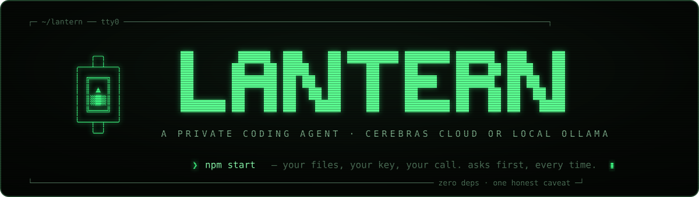
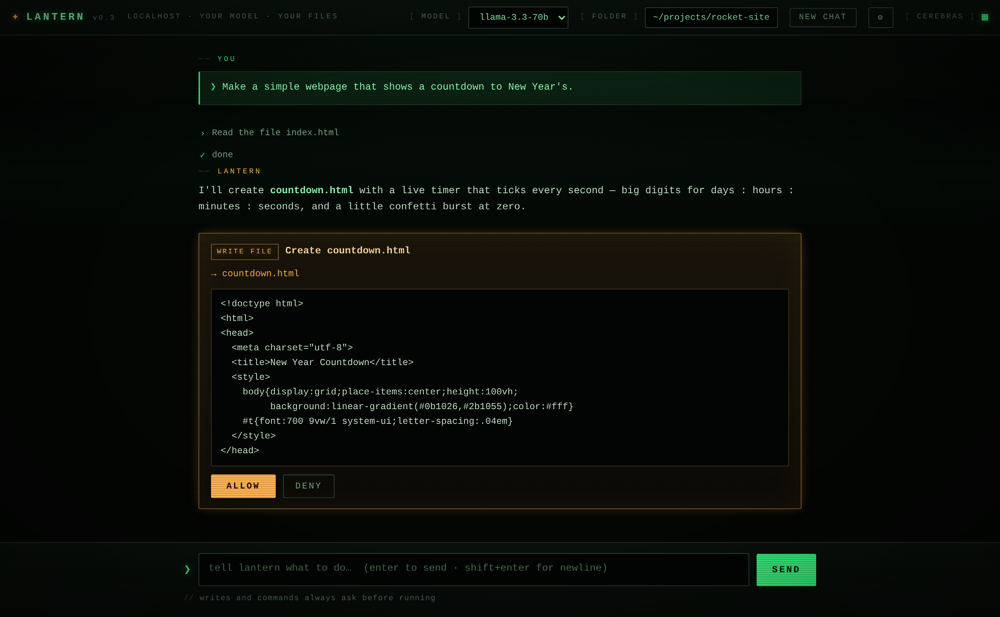
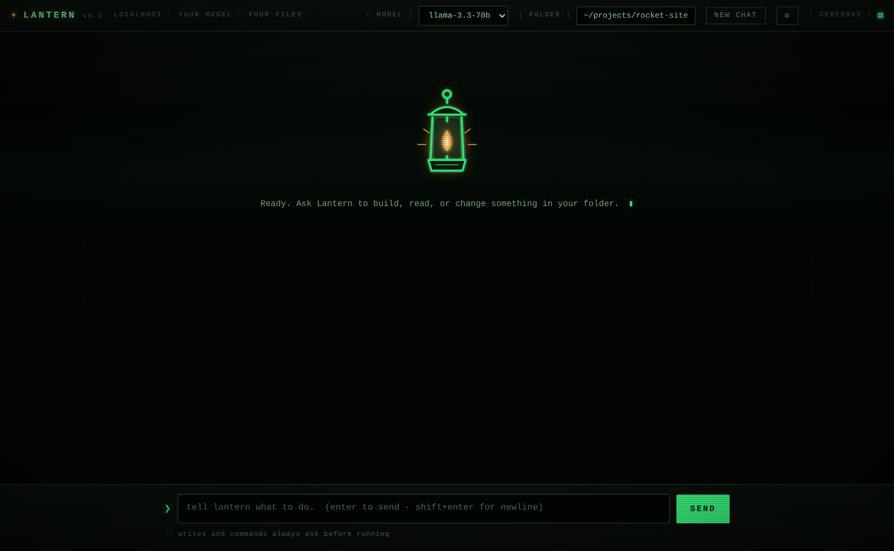
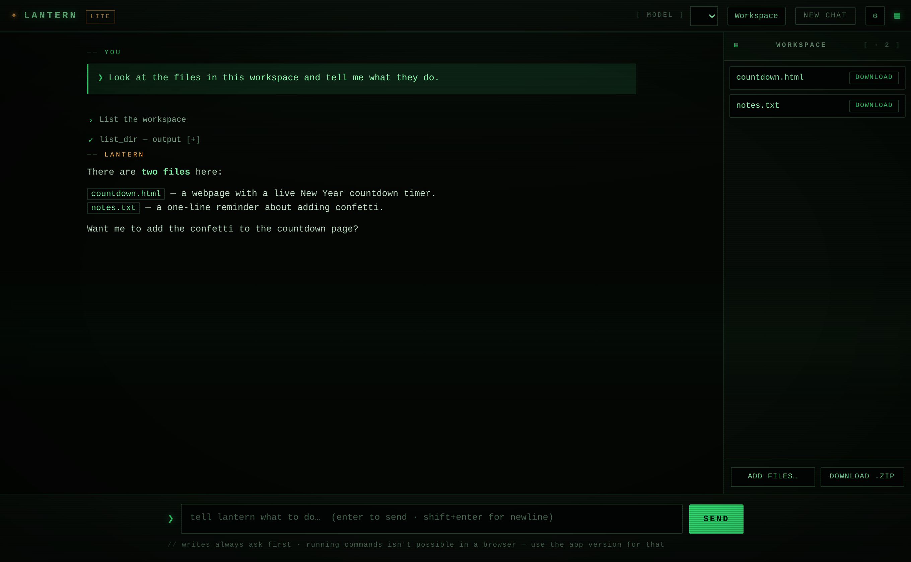
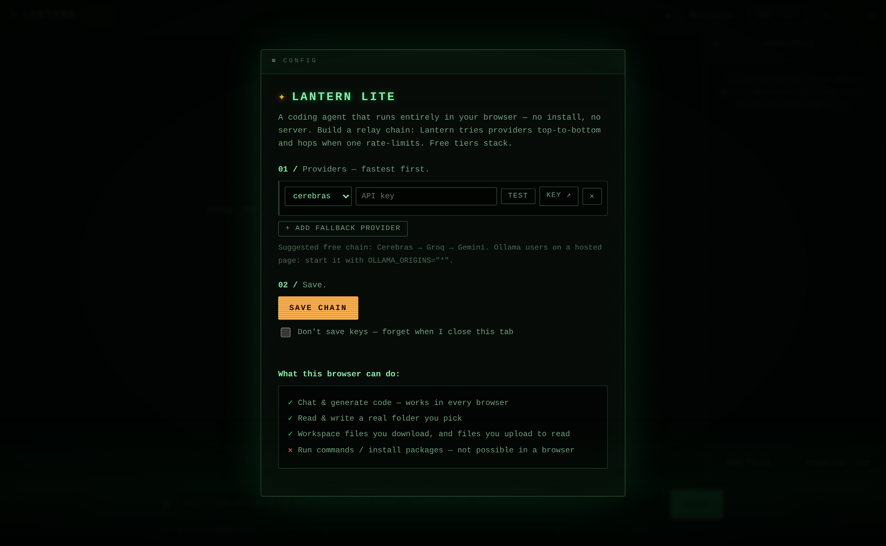

<div align="center">



<br/><br/>

[](LICENSE)
[](https://nodejs.org)
[](package.json)
[](https://ollama.com)
[](https://jammx2.github.io/lantern/)
[](CONTRIBUTING.md)

**A free, private AI helper for everyone, and a coding agent that asks before it acts. It runs on _your_ computer with _your own_ AI: a free key it walks you through getting, the AI app you already have (Ollama, LM Studio, Jan, GPT4All…), or any OpenAI-compatible API.**

Never used AI before? Lantern shows you what to ask, gets you a free key in about two minutes, and answers in plain words: write an email, explain something, plan a week, quiz yourself, build a web page.
When it works with your files it **always shows you exactly what it's about to do and waits for your OK**.
Nothing goes anywhere except to the AI service you chose — and with AI on your own computer, nothing leaves it at all.

**[Try Lantern Lite in your browser →](https://jammx2.github.io/lantern/)** — free, no install, no account with us

Have Node.js? One command starts the full app: `npx github:JAMMx2/lantern`

Works on **macOS** · **Linux** · **Windows**

</div>

---

## See it

The approval card is the whole idea — nothing writes or runs until you say so:



<table>
  <tr>
    <td width="50%"></td>
    <td width="50%"></td>
  </tr>
  <tr>
    <td align="center"><sub>Power on — the phosphor boot screen</sub></td>
    <td align="center"><sub>Lantern Lite — in-browser workspace</sub></td>
  </tr>
</table>

---

## New in 0.7: a free AI helper anyone can use

- **Things to try, right on the home screen.** Cards like *Write an email*, *Explain it simply*, *Fix my writing*, *Plan something*, *Brainstorm ideas*, *Quiz me*, *Make a web page* and *Read a document*. Click one and the box fills with a sentence to finish, with the part to change already selected.
- **A free key in about two minutes.** Setup walks you through getting a free key from Gemini (just a Google account), Groq or Cerebras, step by step, with a button that opens the right page. Paste the key and Lantern connects by itself.
- **An everyday assistant, not just a coding tool.** It answers questions, writes, explains, plans and tutors, knows today's date, and only touches files when you ask it to make or change something.
- **Answers that read well.** Headings, numbered and bulleted lists, tables, quotes and links are formatted properly, safely (nothing an answer contains can run as code in the page).
- **Plain words everywhere.** Setup is four numbered steps: get a free key, or use AI on this computer, check and save, take it to another device.

## New in 0.6: use the AI you already have, no terminal

If an AI app is on your computer, Lantern finds it. Open setup and it checks for **Ollama, LM Studio, Jan, GPT4All, Msty, KoboldCpp, llamafile, Docker Model Runner, Text Generation WebUI and vLLM**:

- **Running with a model?** It's added to your chain. Click **Save** and start typing.
- **Installed but switched off?** Lantern shows the exact clicks to turn its server on, and for Ollama and LM Studio a **Start** button does it for you.
- **Ollama with no models yet?** Pick one from the list (Lantern suggests the size that fits your computer's memory) and click **Download**. A progress bar shows the download; when it finishes, Ollama joins your chain.
- **Nothing installed?** Lantern points you to Ollama's or LM Studio's normal installer. Install, open, press **Find** again.

You never type a command. More cloud APIs are recognised too: paste NVIDIA, Hugging Face, DeepSeek, OpenAI, xAI, Together or Fireworks keys alongside the free ones. **Paid APIs always go last in the chain**, so Lantern only spends money when nothing free can answer.

## New in 0.5: paste once, run anywhere

**Spark: paste anything.** Copy every API key you have (a whole `.env` file, a notes doc, keys in any order) and paste it into one box. Lantern works out which provider each key belongs to from its format, tests them all at the same time, picks a tool-calling coding model for each, orders them fastest-first, and adds Ollama if it's running on your machine. You review the chain and click **Save**. That's the whole setup.

**Lantern Pass: your setup in one link.** Pack your chain into a single string, sealed with a passphrase, and open it anywhere: paste it into Spark on another computer, or open it as a link to set up Lantern Lite on a Chromebook or a borrowed laptop in one step. No account and no cloud sync. The link keeps the pass after the `#`, which browsers never send to a server. A **recipe** pass leaves the keys out, so a team can share "our chain" and each person adds their own keys.

**Relay lights.** The header shows one lamp per provider in your chain: amber while it answers, green when it answered last, red while it rests after a rate limit (hover for the countdown). When Lantern hands a request down the chain, the chat says so: `cerebras rate-limited · trying groq`.

---

## Two ways to run Lantern

**1. The app** (this repo's `bin`/`src`/`install`). Full power: reads and writes your files *and* runs shell commands (install packages, run scripts, use git). Needs Node.js installed. Best when you can install software on your machine.

**2. Lantern Lite** ([`lantern-lite.html`](lantern-lite.html)). A single file that runs entirely in your browser — **no install, no server, no Node**. For locked-down machines, Chromebooks, or anyone who can't install anything. It can read and write your files, but it **cannot run commands** (browsers don't allow that). [Use the hosted version](https://jammx2.github.io/lantern/), or just double-click the file.

| | The app | Lantern Lite |
|---|---|---|
| Spark setup, Lantern Pass, relay lights | Yes | Yes |
| Use AI already on this computer | Finds, starts, and downloads models, no settings | Finds apps that allow web pages; downloads into Ollama when it can reach it |
| Read, search & write your files | Yes, everywhere | Yes on Chrome/Edge; upload+download elsewhere |
| Edit files with a diff preview | Yes | Yes |
| Run commands / install packages | Yes | No, not possible in a browser |
| Chat history & resume | `~/.lantern/sessions` | this browser's localStorage |
| `/undo` the last file change | Yes | Yes |
| Token usage counter | Yes | Yes |
| Project notes (`LANTERN.md`) | Yes | Yes |
| Install required | Node.js | none, just a browser |

Both run the same relay chain, both stream, and both ask before writing anything.

---

## The relay — free tiers, stacked

Lantern doesn't use *a* provider. It holds a **relay chain** of OpenAI-compatible endpoints, tried top-to-bottom — and when one rate-limits you (HTTP 429), it hops to the next **automatically, mid-session**, then benches the limited one for a minute. Your free quotas stack:

| Link | Speed | Free tier | Get a key |
|---|---|---|---|
| **Cerebras** | ~1,800 tok/s | ~1M tokens/day | [cloud.cerebras.ai](https://cloud.cerebras.ai/) |
| **Groq** | 500–3,000+ tok/s | 14,400 requests/day, forever | [console.groq.com/keys](https://console.groq.com/keys) |
| **SambaNova** | 400–600+ tok/s | persistent free tier, huge models | [cloud.sambanova.ai](https://cloud.sambanova.ai/) |
| **Gemini** | fast | generous free tier | [aistudio.google.com/apikey](https://aistudio.google.com/apikey) |
| **Mistral** | fast | free Experiment plan (Devstral, Codestral) | [console.mistral.ai](https://console.mistral.ai/api-keys) |
| **OpenRouter** | varies | `:free` models from many labs | [openrouter.ai/keys](https://openrouter.ai/keys) |
| **NVIDIA** | fast | free developer credits, open models | [build.nvidia.com](https://build.nvidia.com/) |
| **Hugging Face** | varies | free monthly credits, open models | [huggingface.co/settings/tokens](https://huggingface.co/settings/tokens) |
| **AI on this computer** | your hardware | **free forever, offline, fully private** | none — see [AI on this computer](#ai-on-this-computer-no-terminal) |

Paid APIs work too and always sit at the end of the chain: **DeepSeek**, **OpenAI**, **xAI**, **Together AI** and **Fireworks**. Any other OpenAI-compatible endpoint can be added as a custom link.

Build the chain at first run (or open **Settings** any time). The fast way is **Spark**: paste all your keys into the top box and Lantern fills in the chain for you. The manual way still works: add a row per provider, **Test**, pick a model, **Save chain**. One provider is fine too — the chain can be a single link.

Spark recognises keys by their published prefixes (`csk-` Cerebras, `gsk_` Groq, `AIza` Gemini, `sk-or-v1-` OpenRouter, `nvapi-` NVIDIA, `hf_` Hugging Face, `sk-proj-` OpenAI, `xai-` xAI, `tgp_v1_` Together, `fw_` Fireworks). Keys without a distinctive prefix count when the provider is named on the same line or the line above (`MISTRAL_API_KEY=…`, `DEEPSEEK_API_KEY=sk-…`, or `SambaNova:` followed by the key); a bare UUID is read as a SambaNova key. A key it can't place is listed, masked, and sent nowhere.

Responses **stream in live**, token by token, and the header shows which link answered. Lantern also keeps its prompts byte-stable between requests, so providers with prompt caching (Cerebras's cache-aware limits, for one) give you more free tokens and faster starts.

For local models, pick one that supports tool calling — `qwen2.5-coder:7b` or `llama3.1:8b` are good starts.

---

## Get started (non-technical, ~3 minutes)

**Fastest, if you already have Node.js:** run `npx github:JAMMx2/lantern` in a terminal. It downloads Lantern, starts it, and opens your browser. Then skip to step 4.

**1. Get the code.** Download this project (green **Code** button → **Download ZIP**) and unzip it. Or:

```
git clone https://github.com/JAMMx2/lantern.git
```

**2. Install Node.js** (a free tool that runs Lantern), if you don't have it: go to <https://nodejs.org>, download the **LTS** version, install it.

**3. Start Lantern:**

- **macOS:** open the `install` folder and double-click `install-mac.sh` (or in Terminal: `bash install-mac.sh`).
- **Linux:** run `bash install/install-linux.sh`.
- **Windows:** open the `install` folder, right-click `install-windows.ps1` → **Run with PowerShell**.

**4. Spark your chain.** Your browser opens to Lantern. The first time, it asks for your providers:

- Get one or more free keys: [Cerebras](https://cloud.cerebras.ai/) (no credit card), [Groq](https://console.groq.com/keys), [Gemini](https://aistudio.google.com/apikey). More keys means rate limits never stop you.
- Paste them all into the **Spark** box at once. Lantern tests each one, picks a model, and lists the chain. Click **Save chain**.
- Already set up on another computer? Paste your **Lantern Pass** into the same box instead.
- **No keys at all?** Use AI on your computer instead. Setup lists what it finds; see the next section.

Then pick the **folder** you want Lantern to work in (top right), choose a **model**, and start typing.

---

## AI on this computer (no terminal)

Setup's **AI already on this computer?** panel looks for these apps on their usual ports. If one is installed but its server is off, Lantern shows how to switch it on:

| App | How to switch its server on | Lantern can |
|---|---|---|
| [Ollama](https://ollama.com/download) | Open the app (it sits in the menu bar or system tray) | start it, and download a coding model for it |
| [LM Studio](https://lmstudio.ai/download) | Developer tab → set the server to **Running**, load a model | start its server |
| [Jan](https://jan.ai/download) | Settings → Local API Server → **Start Server** | open the app |
| [GPT4All](https://www.nomic.ai/gpt4all) | Settings → tick **Enable Local API Server** (its server may not use tools) | — |
| [Msty](https://msty.ai) | Make sure its Local AI service is installed | open the app |
| [KoboldCpp](https://github.com/LostRuins/koboldcpp/releases) | Open it, pick a model file, press **Launch** | — |
| [llamafile](https://github.com/mozilla-ai/llamafile) | Double-click the `.llamafile` (on Windows, rename it to `.exe` first) | — |
| [Docker Model Runner](https://docs.docker.com/ai/model-runner/) | Docker Desktop → Settings → AI → enable it with host-side TCP | open Docker Desktop |
| Text Generation WebUI, vLLM | Start with the OpenAI-compatible API on its default port (5000 / 8000) | — |

**Downloading a model into Ollama:** Lantern offers small coding models that support tools (`qwen2.5-coder` 1.5B to 14B, and `qwen3-coder:30b` for big machines) and preselects the largest that fits your computer's memory. It uses Ollama's own download API, the same thing `ollama pull` does, with a progress bar and a Cancel button.

**In Lantern Lite** the browser can only see apps that allow web pages to call them: in LM Studio, switch on **Enable CORS** in the server settings; Jan allows it by default. Lite can't tell which apps are installed or start them. On a hosted page it only looks when you press **Find**, because your browser may ask permission first. The full app (`npx github:JAMMx2/lantern`) finds and starts everything with no settings at all.

## How to use it

Just tell it what you want, in plain language, or pick one of the cards on the home screen:

- *"Help me write a short, friendly email to my landlord about the broken heater."*
- *"Explain how compound interest works, like I'm new to it."*
- *"Plan a week of cheap, healthy dinners for two. Make it a checklist."*
- *"Quiz me on the planets with 5 questions, one at a time."*
- *"Make a simple webpage that shows a countdown to New Year's."*
- *"Look at the files in this folder and tell me what they do."*
- *"Fix the typo in notes.txt where it says 'teh'."*

When Lantern wants to **create/change a file** or **run a command**, it stops and shows you the exact thing in a glowing amber card. Changes to an existing file are shown as a **diff** (red lines go away, green lines come in) so you can see precisely what moves. Click **Allow** or **Deny**. Reading and searching files inside your chosen folder happens automatically (it can't read anything outside that folder).

Lantern remembers the conversation, so you can say *"now change line 3 of that file"* and it knows which file. Click **New chat** to start fresh, or **History** to pick up an earlier chat where you left off.

### Slash commands

| Command | What it does |
|---|---|
| `/undo` | Revert the last file Lantern wrote or edited in this chat (new files are removed, edited files are restored). Press it again to go back further. |
| `/history` | Open the list of saved chats. |
| `/new` | Start a fresh chat. |
| `/spark` | Open setup with the Spark box ready, to rebuild your chain from pasted keys. |
| `/pass` | Open the Lantern Pass panel to take your setup to another device. |
| `/export` | *(Lite)* Download the chat as a Markdown file. |
| `/help` | List the commands. |

### Project notes: `LANTERN.md`

Put a `LANTERN.md` file in the folder you open and Lantern reads it at the start of every turn: coding conventions, what the project is, things to never touch. Keep it short (it is capped at 8,000 characters).

### Tokens

The header shows how many tokens this chat has used (in / out) whenever your provider reports usage, so you can watch your free tier.

### Lantern Pass

Open **Settings** (or type `/pass`) once your chain is saved, and choose:

- **Sealed**: includes your keys, encrypted with a passphrase. Lantern suggests a strong one (`K7QM-2XTP-9WRE-HN4D`); you can type your own (10+ characters). Use it to move your own setup between computers.
- **Recipe**: endpoints and models only, no keys. Safe to post in a team chat; everyone pastes it into Spark and adds their own keys.

**Make pass** gives you the pass and a link. Paste the pass into Spark (in the app or Lite), or open the link: Lite reads the pass, removes it from the address bar, asks for the passphrase if it's sealed, and fills in the chain for you to save. The passphrase is never inside the pass or the link, so send it separately or keep it to yourself. The same pass works in the app and in Lite.

---

## What makes it safe

- **You bring your own AI.** Keys are stored only on your computer (in `~/.lantern/config.json`, owner-only permissions) and sent only to the provider you chose. With local Ollama there is no key and no cloud at all.
- **Spark never guesses with your keys.** Each pasted key is matched to one provider by its format (or a provider named next to it) and only ever sent there. It never tries a key against several services to see which one accepts it.
- **Local apps are started only when you click.** A Start button runs a fixed command (open the Ollama app, `lms server start` for LM Studio), never anything typed or suggested by the AI, and model downloads go only to Ollama on this computer.
- **Paid APIs go last.** A pasted paid key never jumps ahead of a free tier, so a rate limit on a free link is the only thing that hands a request to a paid one.
- **Passes are encrypted.** A sealed Lantern Pass is AES-256-GCM with a key derived from your passphrase (PBKDF2-SHA256, 600,000 rounds). Without the passphrase it's noise. A pass can't relabel an endpoint either: a link's provider is decided by its URL, so a shared recipe can't dress up a stranger's server as "groq" to collect your key.
- **Writes and commands always ask first.** You see the full file or the exact command before it runs.
- **Files stay in the folder you pick.** Lantern can't read or write outside it — including through symlinks that point elsewhere (checked by resolving real paths). No touching the rest of your computer's files.
- **Locked to your machine.** Lantern only listens on your own computer (localhost) and rejects requests from any website open in your browser, using a one-time token and a host check — so a malicious page can't quietly drive the agent.
- **No hidden dependencies.** Lantern is built only with what comes with Node.js. There are no third-party packages to trust. `npm install` is never run.

> One honest caveat: a coding agent that can run shell commands is powerful by design. Commands run with your normal user permissions, which is why every command is shown to you and requires your approval. Only allow commands you understand. When in doubt, click Deny and ask Lantern to explain first.

See [SECURITY.md](SECURITY.md) for the threat model and how to report issues.

---

## Lantern Lite (no install)

Open [`lantern-lite.html`](lantern-lite.html) — double-click it, or use the **[hosted version](https://jammx2.github.io/lantern/)**. Pick your provider — Cerebras key (there's a "don't save it" option for shared computers), local Ollama, or a custom endpoint — and go.



- **On Chrome or Edge:** click **Workspace → pick a folder** to let Lantern read and write real files in that folder (it asks before each write, and can't touch anything outside it).
- **On Safari, Firefox, or when opened directly from disk:** Lantern uses an in-browser workspace instead — files it creates appear on the right to **download** (individually or as a `.zip`), and you can **upload** files to let it read them.
- **What Lite can do (v0.5):** **Spark** setup from pasted keys; open and make **Lantern Pass** links; **relay lights**; read, search and write files; **edit files with a diff preview** before you approve; **chat history** saved in your browser with resume; **/undo** the last file change; **token usage** in the header; **Export** any chat as Markdown; reads `LANTERN.md` project notes from the workspace. Still single-file, zero dependencies, and the only network calls are to the providers in your chain. Spark tests keys straight from your browser; nothing goes through a Lantern server, because there isn't one.
- **Hosting over https is what unlocks real-folder access** on Chrome/Edge — which is why this repo ships with a GitHub Actions workflow that publishes Lite to GitHub Pages automatically (see below).

Your key is stored only in your browser on your device (or not at all, if you chose session-only), and is sent only to your chosen provider. Using Ollama from the hosted page? Start it with `OLLAMA_ORIGINS="*"` so the browser may connect.

### Deploy your own copy

1. **Fork** this repo (top right).
2. In your fork: **Settings → Pages → Source: GitHub Actions**.
3. Push anything (or run the *Deploy Lantern Lite* workflow from the **Actions** tab).
4. Your copy is live at `https://<your-username>.github.io/lantern/`.

---

## For developers

```
lantern/
  lantern-lite.html   # serverless browser version (open or host; no Node needed)
  bin/lantern.js      # CLI: starts the local server, opens the browser
  src/
    server.js         # native http server, NDJSON streaming, approval bridge, history routes
    agent.js          # the tool-calling loop, LANTERN.md context, usage accounting
    cerebras.js       # OpenAI-compatible relay client (streaming, usage, failover, relay status)
    spark.js          # provider catalog, Spark key detection, model picking, local discovery, Lantern Pass; shared with Lite
    local.js          # installed-app detection, one-click start, Ollama model downloads (app only)
    markdown.js       # safe Markdown renderer for chat answers; embedded in both pages
    tools.js          # list/read/search/write/edit/run/git + path confinement + undo
    diff.js           # unified diff for approval cards
    sessions.js       # ~/.lantern/sessions/*.json
    cli.js            # --port / --dir / --model parsing
    config.js         # ~/.lantern/config.json
  scripts/sync-shared.js # copies src/spark.js and src/markdown.js into the pages (npm run sync)
  test/               # node:test suite (npm test); fake-provider.js is a local OpenAI-compatible stub
  public/index.html   # the whole UI (single file, vanilla JS, zero deps, CRT included)
  install/            # per-OS launchers
  docs/assets/        # banner + screenshots
  .github/workflows/  # auto-deploy of Lantern Lite to GitHub Pages
```

- **Requirements:** Node 18+ (uses native `fetch`, `http`, `fs`, `child_process`). No `npm install` needed.
- **Run directly:** `node bin/lantern.js` (or `npm start`). Flags: `--port <n>` (default 4317 or `$PORT`; auto-increments if busy), `--dir <path>` (working folder), `--model <id>` (model for the first provider), `--no-open`, `--version`, `--help`. Set `LANTERN_HOME` to move config and history away from `~/.lantern`.
- **Tests:** `npm test` runs the `node:test` suite (tool confinement, edit/undo, diff, CLI parsing, server auth, Spark detection, Lantern Pass crypto, relay failover against a local fake provider, and a check that Lite's embedded Spark matches `src/spark.js`). No test framework to install.
- **Shared code.** `src/spark.js` is imported by the app and embedded in `lantern-lite.html`; `src/markdown.js` (the chat's safe Markdown renderer) is embedded in both pages. Each copy sits between `// <spark>` / `// <markdown>` markers. Edit the module, then run `npm run sync`; the test suite fails if a copy drifts.
- **API:** any OpenAI-compatible endpoint works — Cerebras, Groq, SambaNova, Gemini (OpenAI mode), Ollama, LM Studio… The relay lives in `src/cerebras.js`: streaming SSE client with incremental tool-call assembly, plus per-provider cooldown benching (60s after a 429). Model lists are fetched live and filtered to chat-capable models.
- **Events:** the server streams NDJSON — `provider`, `relay` (per-link lamp state), `hop` (a failover, with the reason), `context`, `assistant_delta`, `assistant_done`, `usage`, `tool_activity`, `tool_request` (with `diff`/`preview`), `tool_result`, `error`, `done`.
- **Setup routes:** `POST /api/spark` (`{text, passphrase?, verify?}` → a tested, ordered chain for the page to review; saved keys are reused but never sent back to the page), `POST /api/pass` (`{sealed, passphrase}` → a pass and a Lite link, made from the saved chain), `GET /api/local` (every local app: running with its models, installed, or neither; plus the Ollama model list sized to this computer), `POST /api/local/start` (`{id}`), and `POST /api/local/pull` (`{model}` → NDJSON download progress).
- **Adding a provider:** one entry in `SPARK_PROVIDERS` in `src/spark.js` (kind `free`, `paid` or `local`; base URL; key pattern or name hint; signup link), then `npm run sync`. Local apps also get a default port and a `howTo` line; to let the app detect or start one, add its install paths to `src/local.js`.
- **Tools:** `list_dir`, `read_file`, `search_files`, `git` (status/diff/log, read-only) run automatically; `write_file`, `edit_file`, `run_command` stop for approval. The approval card for file changes carries a unified diff built by `src/diff.js`.
- **History:** one JSON file per chat in `~/.lantern/sessions/` (owner-only permissions), written after every step. The `/undo` stack lives in the same file.
- **Extending:** add a tool by (1) implementing it in `tools.js`, (2) adding its JSON schema to `TOOL_DEFS`, (3) deciding whether it belongs in `NEEDS_APPROVAL`, (4) adding a test in `test/`.
- **The UI** is a deliberate retro phosphor terminal — scanlines, glow, and approval cards are pure CSS. No images, fonts, or scripts are loaded from anywhere. If you rename the product, change the name in `package.json`, the wordmarks in `public/index.html` + `lantern-lite.html`, and the config folder in `src/config.js`.

Contributions welcome — see [CONTRIBUTING.md](CONTRIBUTING.md).

---

## The mark

The lantern mark is an ASCII sprite rendered with the pipeline from [JAMMSPRITE](https://github.com/JAMMx2/JAMMSPRITE) — same ramp, solid fill, and despeckle that powers its animated cats.

---

## License

[MIT](LICENSE) © 2026 JAMMx2

<div align="center">

`> telemetry .............. none` ✦ `> cloud lock-in .......... none`

</div>
